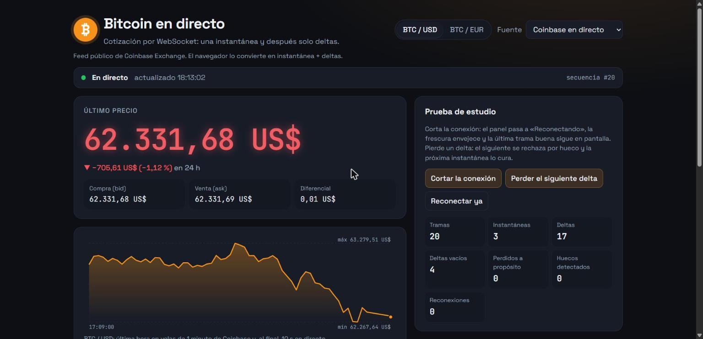

# Bitcoin en directo · deltas por WebSocket

Aplicación de React que pinta la cotización de Bitcoin en tiempo real con WebSockets. **El socket solo envía un valor cuando cambia la cotización, no de forma continua:** al conectar llega una instantánea completa y después solo los cambios (deltas), con número de secuencia para detectar si se pierde alguno.

Funciona con un servidor real de cripto (Coinbase) o con datos simulados (mock).

**Web:** https://alexxblaro16.github.io/btc-delta-sockets/

Proyecto de la [Unidad 10 de Front End II (UDIT)](https://ruvebal.github.io/web-atelier-udit/lessons/en/feii/unit-10-iot-python-backend/): consumir un flujo de datos con estado en React, con el ciclo de vida completo de la conexión (abrir, reconectar, cerrar), datos atrasados y estado visible.



## Qué hace

- **Precio en directo** de BTC/USD o BTC/EUR, con compra, venta, diferencial, variación en 24 h, máximo, mínimo y volumen. El precio destella en verde o rojo al cambiar y el dato que acaba de llegar en un delta se ilumina.
- **Gráfica** de la última hora (velas de 1 minuto de Coinbase) que sigue en directo con cada tick.
- **Estado de la conexión siempre visible:** *En directo* (y «cotización sin cambios desde hace X s» si el mercado está quieto), *Datos atrasados* (15 s sin ningún cambio), *Reconectando* (con el número de intento y la cuenta atrás) y aviso de *hueco en la secuencia*.
- **Prueba de estudio** de la lección, en la propia página:
  - *Cortar la conexión*: pasa a «Reconectando», la última trama buena sigue en pantalla y vuelve sola.
  - *Perder el siguiente delta*: el delta siguiente se rechaza por hueco y la próxima instantánea lo cura.
  - Contadores de tramas, instantáneas, deltas, huecos y reconexiones.
- **Inspector de tramas:** las últimas 14 tal como llegan (tipo, secuencia, contenido y si se aplicó o se rechazó).
- Tema claro y oscuro según el sistema, sin animaciones si el sistema pide menos movimiento, y estado anunciado a lectores de pantalla.

## Cómo funciona

```
Coinbase (wss, ticks completos)
   │
   ├──► navegador: deltaEncoder.js ──┐        (fuente «Coinbase en directo», la de GitHub Pages)
   │                                 │
   └──► backend/main.py (FastAPI) ───┤ instantánea + deltas (contrato v1)
                                     │        (fuente «Servidor FastAPI local»)
        simulador en el navegador ───┘        (fuente «Simulado», sin red)
                                     ▼
                     useDeltaStream.js  →  reduce.js (applyFrame)  →  componentes
```

- **Solo cuando cambia la cotización:** no hay ningún temporizador que envíe cada X segundos. Llega un tick del exchange; si el precio es distinto del último enviado, sale un mensaje; si es igual, no sale nada.
- **Contrato v1** ([docs/contract.md](docs/contract.md)): `{ kind: 'snapshot', sequence, readings }` y `{ kind: 'delta', sequence, patch }`. La secuencia sube de uno en uno con cada mensaje. Cada 8 mensajes va una instantánea completa.
- **`reduce.js`** pliega las tramas: la instantánea sustituye; el delta se mezcla solo si su secuencia es la anterior + 1. Si no, se rechaza y se queda la última trama buena: no se inventan valores.
- **`useDeltaStream.js`** abre la fuente, reconecta con espera exponencial y jitter (1 s → 15 s), reintenta al volver la red y **cierra la conexión al desmontar** o al cambiar de mercado o fuente.
- **Por qué el navegador hace de codificador en Pages:** GitHub Pages no puede ejecutar un proceso y una página HTTPS no puede abrir `ws://127.0.0.1`. El feed de Coinbase es `wss://`, así que el navegador lo escucha directamente y le aplica el mismo codificador que usa el servidor (`deltaEncoder.js` y `backend/delta.py` son el mismo algoritmo, con pruebas a ambos lados).

## Ejecutarlo en local

Front (Node 22 o superior):

```bash
npm install
npm run dev          # http://localhost:5173
npm test             # 23 pruebas (Vitest)
npm run lint
npm run build
```

Backend (Python 3.10 o superior), para la fuente «Servidor FastAPI local»:

```bash
cd backend
python -m venv .venv
.venv/Scripts/activate        # Windows (en macOS o Linux: source .venv/bin/activate)
pip install -r requirements.txt
uvicorn main:app --port 8000  # GET http://127.0.0.1:8000/v1/markets/btc-usd
pytest -q                     # 13 pruebas
```

Sin red, con datos simulados (mock): `BTC_SOURCE=simulated uvicorn main:app --port 8000`.

## Estructura

```
src/
  stream/
    contract.js          contrato v1, URLs y tiempos
    deltaEncoder.js      lectura completa → instantánea o delta
    reduce.js            applyFrame: plegado de tramas con control de secuencia
    sources.js           Coinbase, servidor local y simulador (misma interfaz)
    useDeltaStream.js    conexión, reconexión, frescura y cierre
    *.test.js(x)         pruebas
  components/            StatusBar, PriceHero, Sparkline, MarketStats, StudioTest, DeltaInspector
backend/
  main.py                FastAPI: GET de una trama y WS con instantánea + deltas
  delta.py               el mismo codificador en Python
  tests/                 contrato y codificador (pytest)
docs/
  contract.md            contrato v1
  release-note.md        nota de versión, estrategia de reconexión y una trama real
  ai-declaration-log.md  registro de uso de IA (ACCEPT / REJECT)
```

## Entrega

- Nota de versión: [docs/release-note.md](docs/release-note.md)
- Registro de IA: [docs/ai-declaration-log.md](docs/ai-declaration-log.md)
- CI en GitHub Actions: lint, pruebas y build del front, y pytest del backend. La web se publica sola en GitHub Pages con cada push a `main`.

Datos del feed público de Coinbase Exchange. No es asesoramiento financiero.

Alejandro Blanco Rodríguez · Front End II · UDIT · 2026
